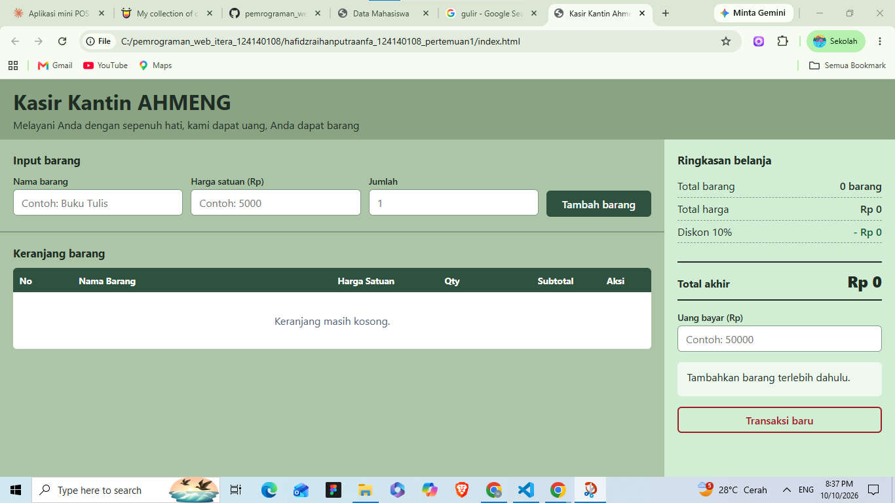
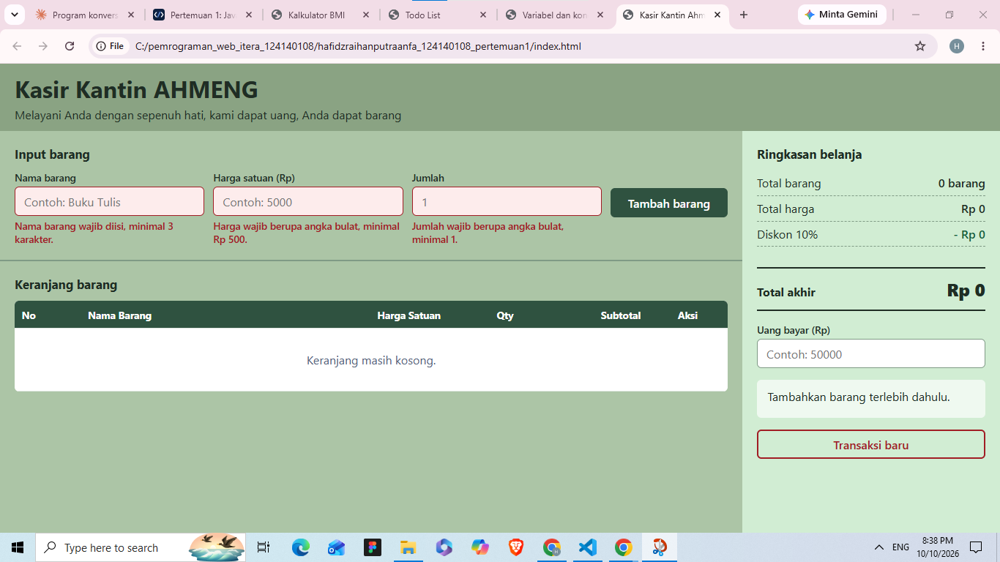
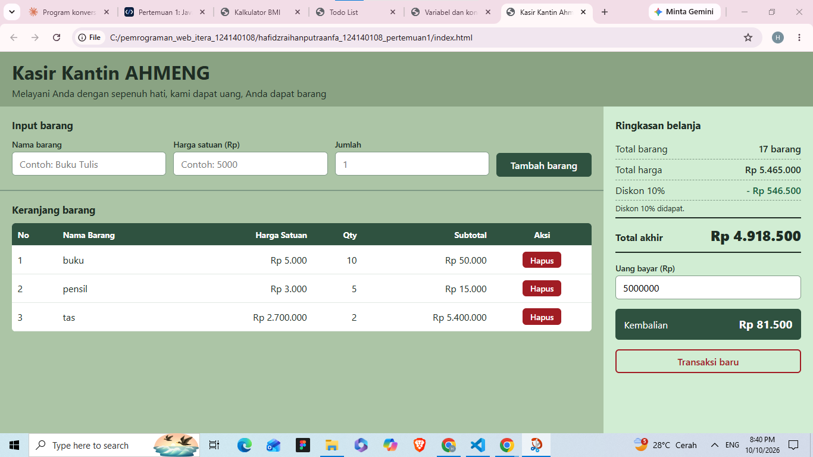

# Kasir Kantin AHMENG (Mini POS)

## Identitas

- **Nama Lengkap:** Hafidz Raihan Putra Anfa
- **NIM:** 124140108
- **Kelas Praktikum:** Pemograman Aplikasi Web RA

## Deskripsi Aplikasi

Kasir Kantin AHMENG adalah aplikasi web kasir sederhana. Kasir memasukkan barang belanjaan, lalu aplikasi menghitung total, diskon, dan kembalian secara otomatis. Daftar belanja tersimpan di `localStorage` sehingga tidak hilang saat halaman di-refresh.

**Tujuan pembuatan:** menyatukan tiga kompetensi dasar praktikum, yaitu validasi input form, perhitungan kalkulator otomatis, dan manajemen keranjang belanja berbasis `localStorage`.

**Studi kasus:** kasir kantin atau toko kampus.

## Panduan Menjalankan

1. Unduh atau clone repository ini, lalu buka folder `hafidzraihanputraanfa_124140108_pertemuan1` di VS Code.
2. Pasang ekstensi **Live Server** (atau Five Server) bila belum ada.
3. Klik kanan `index.html`, lalu pilih **Open with Live Server**.
4. Aplikasi terbuka di browser pada alamat `http://127.0.0.1:5500/`.

## Daftar Fitur

**Validasi Form Input Barang**
- [x] Nama barang wajib diisi, minimal 3 karakter
- [x] Harga satuan wajib angka positif, minimal Rp 500
- [x] Jumlah (qty) wajib bilangan bulat minimal 1
- [x] Pesan error berwarna merah di bawah input yang salah
- [x] Barang tidak masuk keranjang jika data tidak valid
- [x] Form otomatis di-reset setelah barang berhasil ditambahkan

**Kalkulator & Perhitungan Otomatis**
- [x] Subtotal per barang (harga satuan x qty)
- [x] Total belanja dihitung otomatis dari seluruh subtotal
- [x] Diskon 10% jika total belanja minimal Rp 50.000
- [x] Menampilkan nominal diskon dan total akhir
- [x] Input uang bayar dan perhitungan kembalian otomatis
- [x] Keterangan "uang belum mencukupi" jika uang bayar kurang

**Manajemen Keranjang & LocalStorage**
- [x] Tabel keranjang (No, Nama Barang, Harga Satuan, Qty, Subtotal, Aksi)
- [x] Tombol Hapus di setiap baris, total dan diskon terhitung ulang otomatis
- [x] Keranjang disimpan ke `localStorage` (`JSON.stringify`) dan dimuat ulang (`JSON.parse`) sehingga tidak hilang saat halaman di-refresh
- [x] Tombol Transaksi Baru / Reset untuk mengosongkan keranjang dan membersihkan `localStorage`
- [x] Format angka dalam Rupiah
## Tangkapan Layar

**Tampilan form input utama**

**Tampilan saat validasi error muncul**

**Tampilan hasil perhitungan kalkulator dan tabel keranjang**

## Penjelasan Teknis Singkat

### Penanganan validasi input

Saat tombol Tambah barang ditekan, `tambahBarang()` memanggil `validasiForm()`. Fungsi ini memeriksa nama (minimal 3 karakter), harga (angka bulat, minimal 500), dan jumlah (angka bulat, minimal 1). Untuk setiap input, `setError()` menulis pesan merah di bawahnya dan memberi garis merah pada kotak input. `validasiForm()` mengembalikan `true` jika semua benar dan `false` jika ada yang salah. Jika `false`, proses berhenti sehingga barang tidak masuk keranjang. Jika `true`, barang ditambahkan lalu form di-reset.

### Algoritma kalkulator

`hitungRingkasan()` menghitung subtotal tiap barang (`harga x qty`), menjumlahkannya menjadi total belanja dengan perulangan, lalu memberi diskon 10% jika total mencapai Rp 50.000. Total akhir adalah `total - diskon`. Kembalian dihitung `tampilkanKembalian()` dengan rumus `uang bayar - total akhir`, setiap kali kasir mengetik di kolom uang bayar. Jika hasilnya negatif, ditampilkan peringatan bahwa uang belum mencukupi.

### Mekanisme serialisasi localStorage

`localStorage` hanya bisa menyimpan teks, sehingga array `keranjang` diubah menjadi teks JSON dengan `JSON.stringify()` setiap kali barang ditambah atau dihapus (`simpanKeranjang()`). Saat halaman dibuka, `muatKeranjang()` mengubahnya kembali menjadi array dengan `JSON.parse()`, sehingga isi keranjang tetap ada setelah refresh. Tombol Transaksi Baru menghapus data dengan `localStorage.removeItem()`.

