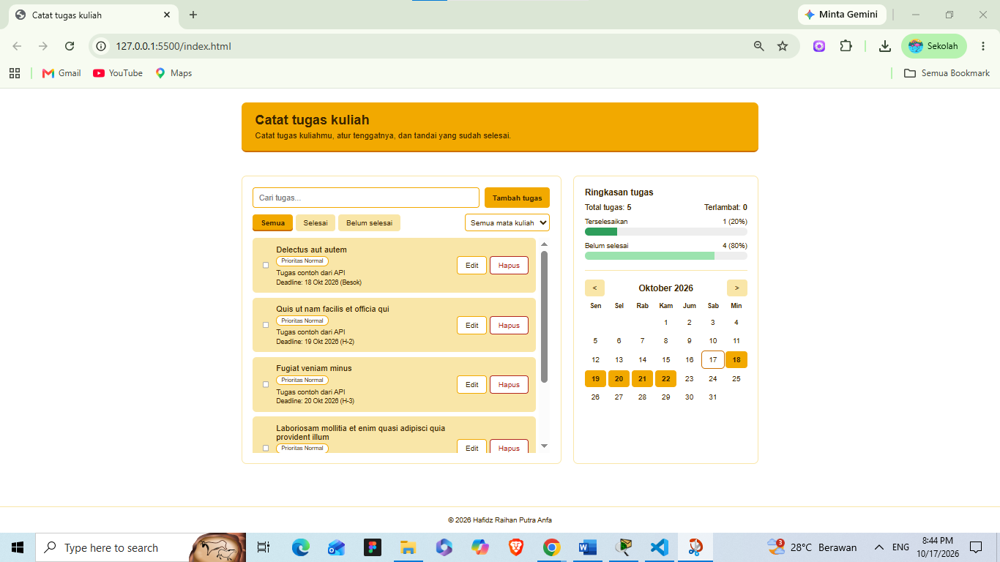
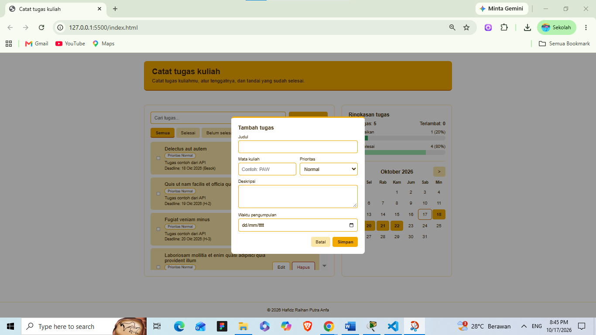
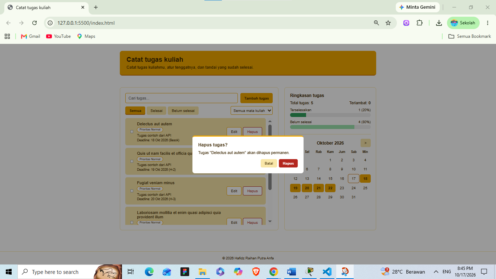
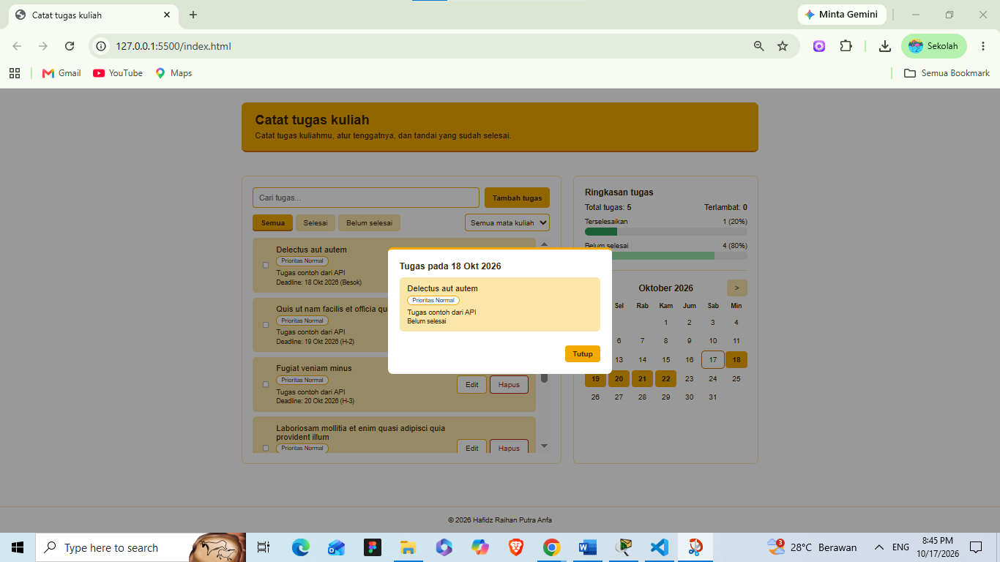

# Identitas

Tugas Praktikum Pertemuan 2 - JavaScript Next Gen (ES6+)

| | |
|---|---|
| Nama | Hafidz Raihan Putra Anfa |
| NIM | 124140108 |
| Kelas | PAW RA |

## Deskripsi aplikasi

**Catat Tugas Kuliah** adalah aplikasi web untuk mencatat tugas kuliah, mengatur tenggatnya, dan menandai tugas yang sudah selesai. Aplikasi dibuat untuk kebutuhan mahasiswa: tiap tugas punya **mata kuliah**, **prioritas**, dan **deadline**, lalu deadline-nya terlihat di kalender. Data disimpan di `localStorage`, jadi tidak hilang saat halaman ditutup.

## Fitur

- **Tambah, edit, dan hapus tugas** lewat form (judul, mata kuliah, prioritas, deskripsi, waktu pengumpulan). Hapus meminta konfirmasi dulu.
- **Centang selesai** pada tiap tugas.
- **Pencarian** berdasarkan judul, deskripsi, atau mata kuliah.
- **Filter** status (Semua, Selesai, Belum selesai) dan filter per mata kuliah.
- **Daftar tugas di kotak sendiri** dengan scroll di dalam kotak, sehingga halaman tidak memanjang saat tugas bertambah. Urutan: belum selesai dulu, deadline terdekat, lalu prioritas tertinggi.
- **Penanda sisa waktu** di samping deadline: "Hari ini", "Besok", "H-3", atau "terlambat 2 hari".
- **Ringkasan tugas**: total tugas, jumlah terlambat, dan dua progress bar (terselesaikan dan belum selesai).
- **Kalender** bulan berjalan dengan highlight tanggal yang punya deadline. Tombol `<` dan `>` menggeser bulan, dan klik tanggal membuka daftar tugas pada hari itu.
- **Data awal dari API**: saat pertama dibuka (localStorage masih kosong), 5 tugas contoh diambil dari JSONPlaceholder.

## Screenshot









## Struktur folder

```text
hafidzraihanputraanfa_124140108_pertemuan2/
├── index.html
├── css/
│   └── style.css
├── js/
│   ├── main.js            # pengendali DOM: render dan event
│   ├── app.js             # class TaskItem dan DashboardApp
│   └── modules/
│       ├── data.js        # konstanta: URL API, kunci localStorage, prioritas
│       └── utils.js       # fungsi bantu: tanggal, kalender, escapeHtml
├── Praktikum/             # latihan tiap materi, masing-masing berisi index.html dan java.js
│   ├── Template Literals/
│   ├── Destructuring dan Spread Rest/
│   ├── Classes dan Object Literals/
│   ├── Modern Array Methods/
│   └── Async Programming/
└── screenshots/
```

## Cara menjalankan

1. Buka folder project di VS Code.
2. Klik kanan `index.html`, lalu pilih **Open with Live Server**.

## Alur data

1. `DashboardApp` membaca `localStorage` saat dibuat (`js/app.js` baris 43).
2. Jika kosong, `init()` memanggil `fetchInitialTasks()` untuk mengambil 5 tugas dari JSONPlaceholder, lalu menyimpannya.
3. Setiap tambah, edit, hapus, atau centang memanggil `save()` (`js/app.js` baris 52), lalu `main.js` merender ulang daftar, ringkasan, dan kalender.

## Daftar fitur ES6+ yang diimplementasikan

| Fitur | Lokasi | Keterangan |
|---|---|---|
| `let` dan `const` | `js/main.js` baris 25, 27, 29; `js/main.js` baris 12; `js/app.js` baris 35, 61 | `let` hanya untuk state yang berubah (bulan kalender, id yang diedit, filter). Selain itu memakai `const`. |
| Arrow functions | `js/main.js` baris 32, 43, 68, 134, 266; `js/modules/utils.js` baris 1, 7, 28; `js/app.js` baris 139 | Jauh lebih dari 3 arrow function, termasuk callback array. |
| Template literals | `js/main.js` baris 47, 104, 206, 272; `js/modules/utils.js` baris 10 | Dipakai untuk render HTML dinamis, pesan, dan format tanggal. |
| Async/await | `js/app.js` baris 56, 57, 76; `js/main.js` baris 266, 269 | Mengambil data awal dari API, dengan penanganan error memakai `try/catch` (`js/app.js` baris 42). |
| Classes | `js/app.js` baris 5, 33 | `TaskItem` memodelkan satu tugas, `DashboardApp` mengelola state, `localStorage`, dan `fetch()`. Instansiasi di `js/main.js` baris 12. |
| Getter | `js/app.js` baris 27 | `isOverdue` pada `TaskItem` menghitung apakah tugas terlambat. |
| Destructuring di parameter | `js/app.js` baris 6, 83, 112, 63; `js/main.js` baris 37 | Parameter fungsi dan constructor langsung membongkar objek. |
| Destructuring variabel | `js/main.js` baris 44, 241 | Mengambil properti dari objek tugas dan `dataset` event. |
| Spread operator | `js/app.js` baris 85, 91, 108, 147; `js/modules/utils.js` baris 52 | Menambah dan memperbarui array atau objek tanpa mengubah data lama (immutable). |
| Default parameters | `js/app.js` baris 9, 112; `js/main.js` baris 168 | Nilai bawaan pada constructor, `getVisibleTasks`, dan `openForm`. |
| Optional chaining dan nullish | `js/main.js` baris 169; `js/app.js` baris 36 | `task?.id ?? null` dan `saved ?? []`. |
| Modules (`import` dan `export`) | `js/main.js` baris 1; `js/app.js` baris 1; `js/modules/data.js` baris 2; `js/modules/utils.js` baris 57 | Kode dipisah ke `main.js`, `app.js`, dan folder `modules/`. |
| Array methods | `js/app.js` baris 146, 124, 97; `js/main.js` baris 79 | `map`, `filter`, `find`, `reduce`, dan `sort` untuk mengolah data tugas. |
| `Map` dan `Set` | `js/app.js` baris 149, 108 | `Map` untuk peta tanggal ke tugas di kalender, `Set` untuk daftar mata kuliah unik. |

## Penyimpanan lokal (`localStorage`)

- Kunci: `dashboard-tugas-v2` (`js/modules/data.js` baris 3).
- Membaca: `js/app.js` baris 43. Menulis: `js/app.js` baris 52.
- Data tugas lama yang belum punya mata kuliah atau prioritas tetap terbaca, dengan nilai bawaan prioritas Normal.

## Sumber API

JSONPlaceholder (gratis, tanpa API key): `https://jsonplaceholder.typicode.com/todos?_limit=5` (`js/modules/data.js` baris 2). API ini tidak punya deadline, jadi tugas contoh diberi deadline 1 sampai 5 hari dari hari pertama aplikasi dibuka.

## Latihan praktikum

Satu latihan dipilih untuk tiap materi, disimpan di folder `Praktikum/`. Setiap latihan punya `index.html` dan `java.js`, dan bisa dibuka langsung di browser.

| Materi | Latihan | Folder |
|---|---|---|
| Template Literals | Arrow function dengan berbagai sintaks (10 variasi) | `Praktikum/Template Literals/` |
| Destructuring & Spread/Rest | Function dengan rest parameters yang mengembalikan statistik (min, max, average) | `Praktikum/Destructuring dan Spread Rest/` |
| Classes & Object Literals | Class `Product` dengan inheritance ke `DigitalProduct` dan `PhysicalProduct` | `Praktikum/Classes dan Object Literals/` |
| Modern Array Methods | Fungsi menghitung rata-rata dari array of objects | `Praktikum/Modern Array Methods/` |
| Async Programming | Mekanisme retry dengan exponential backoff | `Praktikum/Async Programming/` |

