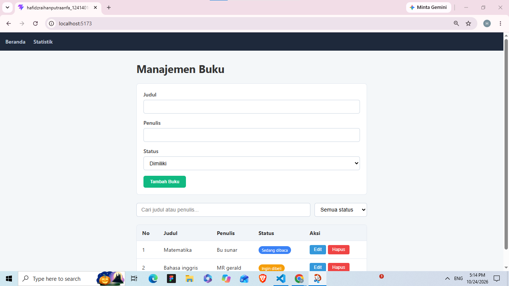
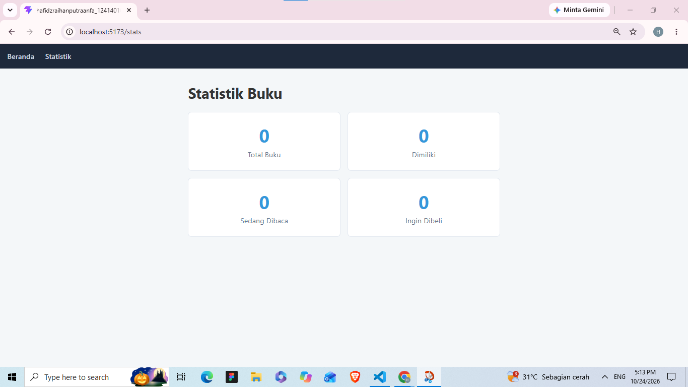
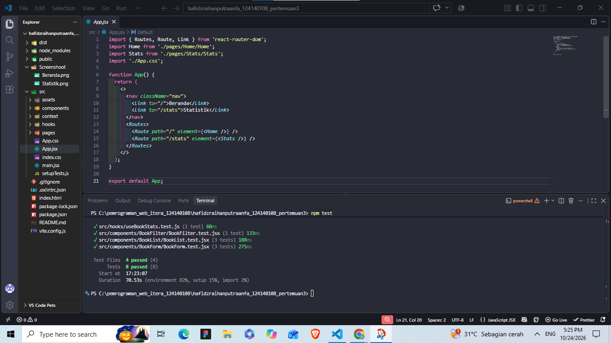

# Identitas

Tugas Praktikum Pertemuan 2 - JavaScript Next Gen (ES6+)

| | |
|---|---|
| Nama | Hafidz Raihan Putra Anfa |
| NIM | 124140108 |
| Kelas | PAW RA |

## Deskripsi Aplikasi Manajemen Buku Pribadi

Aplikasi web untuk mencatat buku pribadi. Setiap buku punya judul, penulis, dan status: **Dimiliki**, **Sedang dibaca**, atau **Ingin dibeli**.

Fitur utama:
- Menambah, mengedit, dan menghapus buku
- Filter buku berdasarkan status
- Pencarian berdasarkan judul atau nama penulis
- Validasi form (judul dan penulis wajib diisi, dengan pesan error dan tampilan merah)
- Halaman Statistik yang menghitung jumlah buku per status
- Data tersimpan di `localStorage`, jadi tidak hilang saat halaman di-refresh

## Teknologi

React 19, Vite, React Router, PropTypes, Vitest, dan React Testing Library.

## Instalasi dan Cara Menjalankan

Pastikan Node.js (versi LTS) sudah terpasang, lalu jalankan di terminal VS Code:

```bash
npm install
npm run dev
```

Buka alamat yang muncul di terminal (biasanya `http://localhost:5173`).

Menjalankan unit test:

```bash
npm test
```

Jika test gagal dengan error worker timeout di Windows, jalankan:

```bash
npx vitest run --pool=threads
```

## Screenshot

### Halaman Beranda


### Halaman Statistik


## Laporan Testing

Hasil eksekusi `npm test`: 4 file test, 8 test, semuanya lulus.



## Struktur Folder

```
src/
├── components/
│   ├── BookForm/      # Form tambah dan edit buku
│   ├── BookList/      # Tabel daftar buku
│   └── BookFilter/    # Pencarian dan filter status
├── pages/
│   ├── Home/          # Halaman utama
│   └── Stats/         # Halaman statistik
├── hooks/
│   ├── useLocalStorage.js
│   └── useBookStats.js
├── context/
│   └── BookContext.jsx
└── App.jsx
```

## Fitur React yang Digunakan

- **useState**: menyimpan state form di `BookForm`, serta buku yang diedit, kata pencarian, dan filter status di `Home`.
- **useEffect**: di `BookForm` untuk mengisi form saat mode edit, dan di `useLocalStorage` untuk menyimpan data ke `localStorage` setiap kali berubah.
- **Komponen reusable**: `BookForm`, `BookList`, dan `BookFilter`. Ketiganya hanya menerima data dan fungsi lewat props, sehingga bisa dipakai ulang dan mudah diuji.
- **Context API**: `BookContext` menyimpan daftar buku beserta fungsi `addBook`, `updateBook`, dan `deleteBook`. Halaman `Home` dan `Stats` mengaksesnya lewat hook `useBooks()` tanpa mengoper props berjenjang.
- **React Router**: dua halaman, yaitu `/` (Beranda) dan `/stats` (Statistik), dengan navigasi `Link` tanpa reload halaman.
- **Custom hook**:
  - `useLocalStorage` membaca dan menyimpan state ke `localStorage`.
  - `useBookStats` menghitung total buku dan jumlah per status.
- **PropTypes**: validasi tipe props pada `BookForm`, `BookList`, `BookFilter`, dan `BookProvider`.
- **Controlled component**: semua input form dan filter nilainya dikendalikan oleh state.
- **Conditional dan list rendering**: pesan error validasi, tombol "Batal" saat mode edit, pesan saat daftar kosong, dan `map()` dengan `key` untuk menampilkan baris tabel.
- **Testing**: 8 unit test dengan Vitest dan React Testing Library untuk `BookForm`, `BookList`, `BookFilter`, dan `useBookStats`.
