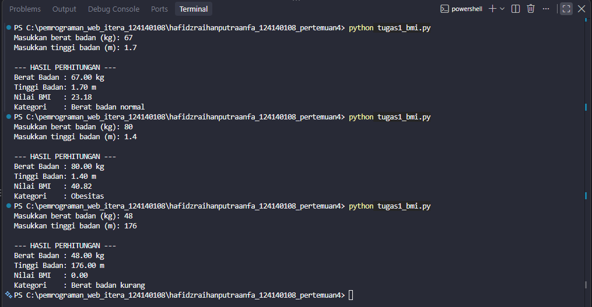
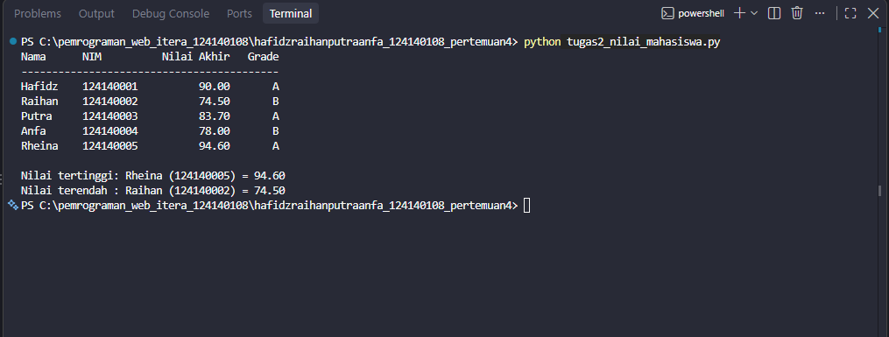
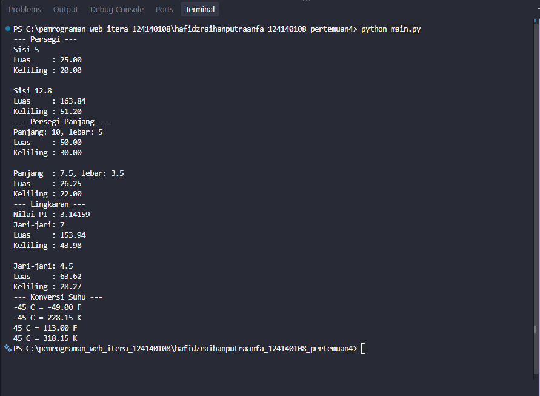

# Praktikum PAW - Pertemuan 4: Python Dasar

Nama  : Hafidz Raihan Putra Anfa
NIM   : 124140108
Kelas : RA

## Deskripsi Program

1. `tugas1_bmi.py`
   Menghitung BMI dari berat (kg) dan tinggi (m) yang diinput, lalu
   menampilkan kategorinya (kurang, normal, berlebih, obesitas).

2. `tugas2_nilai_mahasiswa.py`
   Menyimpan data 5 mahasiswa dalam list of dictionary, menghitung nilai
   akhir (30% UTS + 40% UAS + 30% Tugas), menentukan grade A-E, menampilkan
   tabel, serta mencari nilai tertinggi dan terendah.

3. `math_operations.py` dan `main.py`
   `math_operations.py` berisi konstanta PI, fungsi luas dan keliling
   (persegi, persegi panjang, lingkaran), dan konversi suhu.
   `main.py` mengimpor modul tersebut dan memakai semua fungsinya.

## Cara Menjalankan

```
python tugas1_bmi.py
python tugas2_nilai_mahasiswa.py
python main.py
```

## Screenshot Hasil

Soal 1:



Soal 2:



Soal 3:


