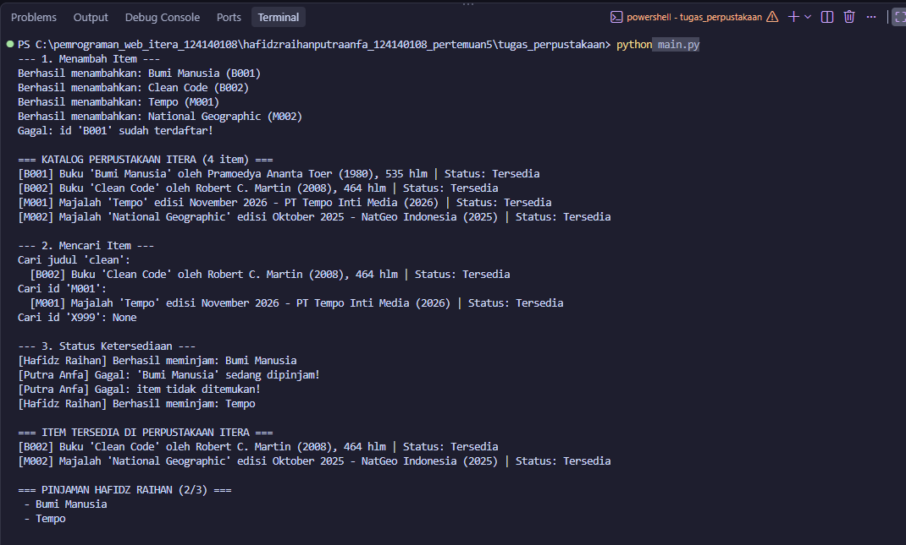
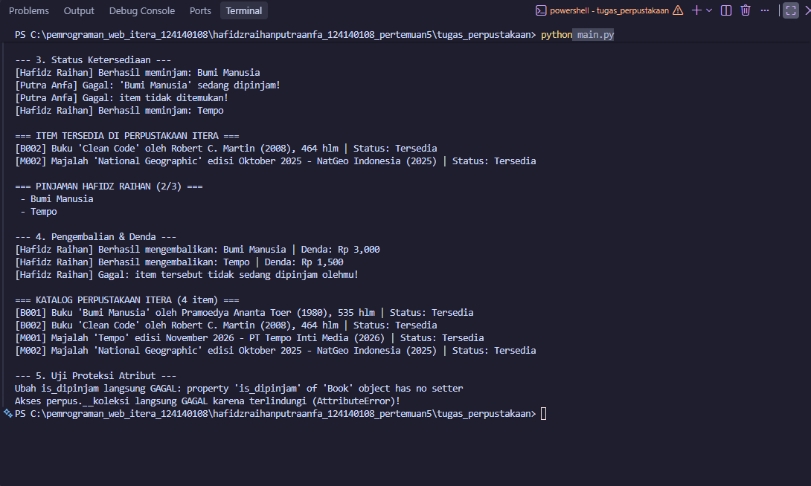

# Identitas

Tugas Praktikum Pertemuan 5 - Python OOP

| | |
|---|---|
| Nama | Hafidz Raihan Putra Anfa |
| NIM | 124140108 |
| Kelas | PAW RA |


## Deskripsi Program

Program ini mengelola koleksi perpustakaan yang berisi buku dan majalah. Pengguna dapat menambah item, mencari item berdasarkan judul atau id, melihat katalog, meminjam, dan mengembalikan item dengan perhitungan denda.

### Alur Program (`main.py`)

1. Membuat objek `Library`, lalu menambahkan beberapa `Book` dan `Magazine`. Penambahan dengan id yang sama ditolak.
2. Menampilkan katalog seluruh item beserta status ketersediaannya.
3. Mencari item berdasarkan judul (kata kunci) dan berdasarkan id.
4. Dua objek `Member` meminjam item. Item yang sedang dipinjam tidak bisa dipinjam lagi, lalu daftar item tersedia ditampilkan.
5. Mengembalikan item dengan jumlah hari terlambat, lalu denda dihitung sesuai jenis item.
6. Menguji bahwa atribut yang dilindungi tidak bisa diubah langsung dari luar class.

### Penerapan 4 Pilar OOP

**1. Class**
`LibraryItem`, `Book`, `Magazine`, `Library`, dan `Member` masing-masing punya atribut dan method sendiri. Objeknya dibuat dan dipakai di `main.py`.

**2. Inheritance**
`Book` dan `Magazine` mewarisi abstract class `LibraryItem(ABC)` dan memanggil constructor induk lewat `super().__init__()`. Keduanya wajib mengimplementasikan abstract method `get_detail()` dan `hitung_denda()`. `LibraryItem` tidak bisa diinstansiasi langsung.

**3. Encapsulation**
- Atribut protected: `_item_id`, `_judul`, `_tahun_terbit` di `LibraryItem`.
- Atribut private: `__dipinjam` di `LibraryItem`, `__koleksi` di `Library`, dan `__daftar_pinjam` di `Member`.
- `@property` (read-only, tanpa setter): `item_id`, `judul`, `tahun_terbit`, `is_dipinjam`, `jumlah_item`, dan `jumlah_pinjaman`.
- Status dipinjam hanya berubah lewat method `pinjam()` dan `kembalikan()`, bukan diubah langsung.

**4. Polymorphism**
`get_detail()` dan `hitung_denda()` punya perilaku berbeda untuk tiap jenis item. Denda buku Rp 1.000 per hari, sedangkan denda majalah Rp 500 per hari. `Library` menyimpan `Book` dan `Magazine` dalam satu koleksi dan memperlakukan keduanya dengan cara yang sama, misalnya saat `print(item)` memanggil `get_detail()` yang sesuai.

## Panduan Menjalankan Program

```bash
cd tugas_perpustakaan
python main.py
```

## Screenshot Output
 
Tangkapan layar terminal saat `python main.py` dijalankan, mendemonstrasikan fitur penambahan item, pencarian item, dan penampilan katalog.
 
**Bagian 1**
 

 
**Bagian 2**
 

 